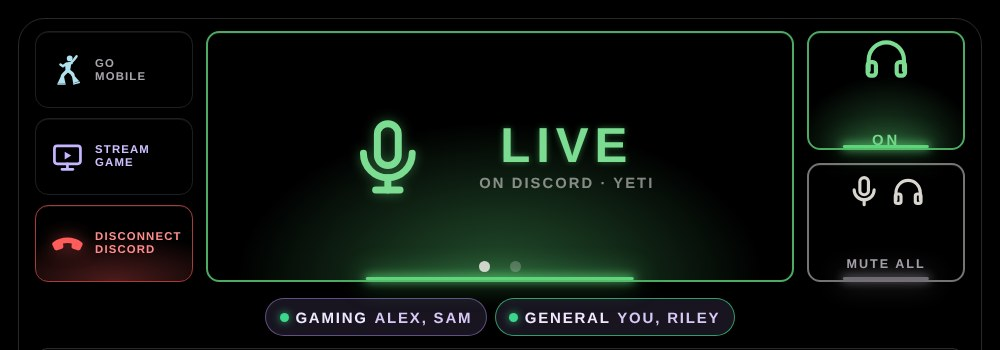
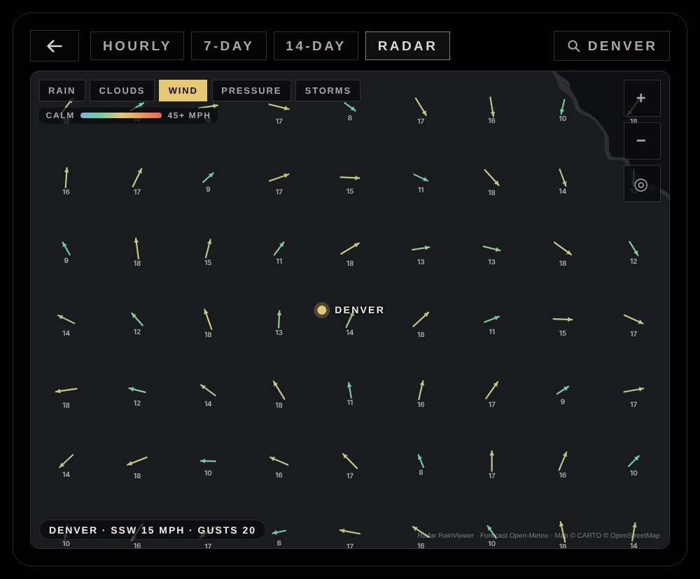

<div align="center">

# Binxbar

**A desk control station for the Corsair Xeneon Edge.**
Mic and Discord controls, a music player, screen controls and a live weather station in one iCUE touch tile.

[](https://github.com/Robo-Binx/binxbar/releases/latest)
[](LICENSE)


[**Download**](https://github.com/Robo-Binx/binxbar/releases/latest) · [Installation](docs/installation.md) · [Stream Deck keys](docs/stream-deck-keys.md) · [Troubleshooting](docs/troubleshooting.md) · [AI-assisted setup](docs/ai-setup.md)

</div>

---

## Features

| | |
|---|---|
| 🎙️ **Mic status** | LIVE / MUTED at a glance, tap to mute, and it knows whether you're actually in a Discord call. |
| ⚠️ **Wrong-mic guard** | Warns when Discord is listening to the wrong mic, or a second mic is still hot after you mute. One tap fixes it. |
| 💬 **Voice bubbles** | Who's in voice on your Discord server, by channel, with join alerts. **Tap a bubble to jump into that channel.** |
| 📡 **STREAM GAME** | Go live in your call with whatever game you're playing. Blinks green while you're live. |
| 📴 **DISCONNECT DISCORD** | Leave any call, DMs included. |
| 🎧 **GO MOBILE** | One tap moves Discord to your headset mic so you can walk away from the desk (optional). |
| 🎵 **Music row** | Spotify, YouTube, SoundCloud, Twitch, VLC and more: previous / play / next and a tap-anywhere volume bar. |
| 🌦️ **Weather station** | Live radar, a 2-hour rain forecast, cloud, wind, pressure and storm layers, and search for any city. |
| 🖥️ **Screen control** | Brightness presets, plus a keyboard key that turns the Edge off and on. |
| 🕒 **Clock & calendar** | Flip clock and a month calendar that can show your Google Calendar. |

<table><tr>
<td></td>
<td></td>
</tr><tr>
<td align="center">Mic row: GO MOBILE, STREAM and DISCONNECT on the left; sound and MUTE ALL on the right</td>
<td align="center">Weather station: wind layer over your area</td>
</tr></table>

## Quick start

> **New to GitHub?** You don't need an account. Click [**Download**](https://github.com/Robo-Binx/binxbar/releases/latest), grab `Binxbar-1.0.0.icuewidget` and `Source code (zip)`, then follow the [installation guide](docs/installation.md).

1. **Install the free programs:** [iCUE](https://www.corsair.com/icue) 5.52+, the [Elgato Stream Deck](https://www.elgato.com/downloads) app (no hardware needed) with its **Discord** and **Audio Mute** plugins, and [Twinkle Tray](https://twinkletray.com) for brightness and the on/off key.
2. **Import the widget:** iCUE → Xeneon Edge → Widgets → **+** → `Binxbar-1.0.0.icuewidget`, then drag it onto the Edge (size M).
3. **Set up the Stream Deck keys:** [stream-deck-keys.md](docs/stream-deck-keys.md).
4. **Start the helper:** edit `mic-guard/mic-guard.ini`, then run `mic-guard.vbs` and `add-to-startup.vbs`.

Full walkthrough: **[docs/installation.md](docs/installation.md)**.

### Let an AI set it up

Hand **[docs/ai-setup.md](docs/ai-setup.md)** to Claude, ChatGPT or any assistant. It's written for the AI: what to ask you, what you click and what it can do itself. An assistant that can run commands on your PC can do most of the setup for you.

## Requirements

- Windows 10/11 and a Corsair Xeneon Edge
- iCUE 5.52 or newer
- Elgato Stream Deck app (free; **no Stream Deck hardware needed**)
- Discord desktop app
- Optional: Twinkle Tray (brightness, on/off key), a free [CARTO](https://carto.com/basemaps/apikey/) key (radar base map)

## How it works

iCUE widgets run in a sandboxed browser that can't launch programs or reach `localhost`. Binxbar gets around that two ways: it **presses keys on a virtual Stream Deck** (mute, volume, Discord join/stream/leave), and it **reads small status files** that a background helper (`mic-guard`) writes into the widget folder. Details: [docs/architecture.md](docs/architecture.md).

```
widget/        the iCUE widget (HTML/JS/CSS)
mic-guard/     background helper: mic watcher, volume, now-playing source, Discord voice feed
edge-display/  Twinkle Tray wrappers: brightness, power, show-player
tools/         build and update scripts
docs/          guides and images
dist/          the packaged .icuewidget
```

## Documentation

| Guide | What's in it |
|---|---|
| [Installation](docs/installation.md) | Every download, step-by-step setup, settings, voice bubbles, brightness and the on/off key, weather station |
| [Stream Deck keys](docs/stream-deck-keys.md) | The 8 × 4 key layout and what each key does |
| [Troubleshooting](docs/troubleshooting.md) | Common problems and fixes |
| [Architecture](docs/architecture.md) | How the pieces talk to each other, customizing, developing |
| [AI-assisted setup](docs/ai-setup.md) | A guide written for AI assistants |
| [Changelog](CHANGELOG.md) | Release history |

## Contributing

Bug reports, ideas and pull requests are welcome. See [CONTRIBUTING.md](CONTRIBUTING.md), and please follow the [Code of Conduct](CODE_OF_CONDUCT.md). Security issues: [SECURITY.md](SECURITY.md). Using a coding agent? Point it at [AGENTS.md](AGENTS.md).

## License & credits

[Apache License 2.0](LICENSE). Clock face adapted from **Flip Clock** by inerthel-agi ([icue-edge-widgets](https://github.com/inerthel-agi/icue-edge-widgets)), Apache-2.0. Radar © RainViewer, forecasts by Open-Meteo, map © CARTO © OpenStreetMap contributors.

Not affiliated with Corsair, Elgato or Discord.
