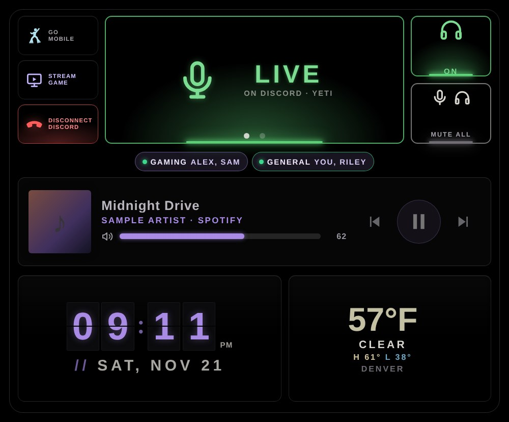
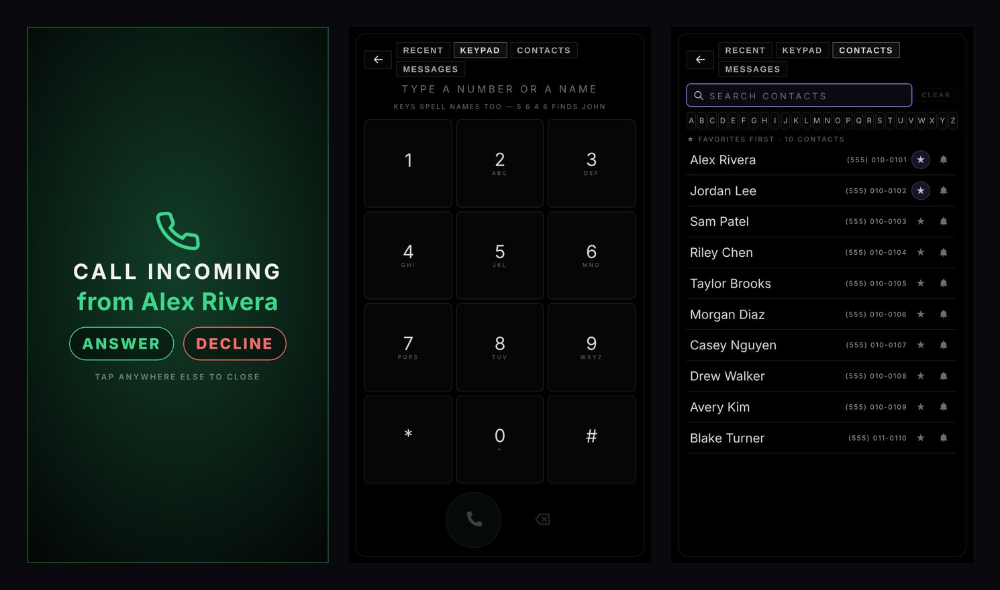

<div align="center">

# Binxbar

**A desk control station for the Corsair Xeneon Edge.**
Mic and Discord controls, phone calls, a music player, screen controls and a live weather station in one iCUE touch tile.

[](https://github.com/Robo-Binx/binxbar/releases/latest)
[](LICENSE)




<sub>Standing up (portrait) and lying sideways. Names, songs and weather in these pictures are made-up examples.</sub>

[**Download**](https://github.com/Robo-Binx/binxbar/releases/latest) · [Installation](docs/installation.md) · [Phone](docs/phone.md) · [Stream Deck keys](docs/stream-deck-keys.md) · [Privacy](docs/privacy.md) · [Troubleshooting](docs/troubleshooting.md) · [AI-assisted setup](docs/ai-setup.md)

</div>

---

## Features

| | |
|---|---|
| 🎙️ **Mic status** | LIVE / MUTED at a glance, tap to mute, and it knows whether you're actually in a Discord call. |
| ⚠️ **Wrong-mic guard** | Warns when Discord is listening to the wrong mic, or a second mic is still hot after you mute. One tap fixes it. |
| 💬 **Voice bubbles** | Who's in voice on your Discord server, by channel, with join alerts. **Tap a bubble to jump into that channel.** |
| 📡 **STREAM GAME** | Go live in your call with whatever game you're playing. Blinks green while you're live. |
| 📴 **ESCAPE DISCORD** | Leave any call, DMs included. |
| 🎧 **GO MOBILE** | One tap moves Discord to your headset mic so you can walk away from the desk (optional). |
| 🔊 **SPEAKER** | One tap moves your PC's sound from your headset to a speaker (Bluetooth or wired), and back (optional). |
| 🎵 **Music row** | Spotify, YouTube, SoundCloud, Twitch, VLC and more: previous / play / next and a tap-anywhere volume bar. |
| 🌦️ **Weather station** | Live radar, a 2-hour rain forecast, cloud, wind, pressure and storm layers, and search for any city. |
| 🖥️ **Screen control** | Brightness presets, plus a keyboard key that turns the Edge off and on. |
| 🕒 **Clock & calendar** | Flip clock and a calendar with **week** and **month** views that can show your Google Calendar. |
| 📞 **Phone calls** *(new)* | Incoming calls take over the tile with **ANSWER / DECLINE** and a soft ringtone; missed calls get **CALL BACK**. Uses Microsoft Phone Link with your own phone. |
| ☎️ **PHONE app** *(new)* | Tap the phone icon: **RECENT** calls, a **KEYPAD** that also spells names, **CONTACTS** with search, A–Z, ★ favorites and 🔔 alert picks, and an on-call screen with timer and **END CALL**. Works by touch or keyboard. |
| 💬 **Text alerts** *(new)* | Texts from people you pick take over the tile (who it's from, never the message) with **REPLY**. |
| 🌗 **Screen follows your monitor** *(new)* | Switch your main monitor off with its own power button and the Edge goes off too, then comes back with its widgets when you switch it on. |
| ⌨️ **Keyboard keys** *(new)* | One key turns the Edge on/off, another flips it between Binxbar and your Windows desktop. |
| ↕️ **Upright or sideways** *(new)* | Works with the Edge standing up (portrait) as well as lying sideways. |

<p align="center"></p>
<p align="center"><sub>Phone: an incoming call takes over the tile · the KEYPAD (spells names too) · CONTACTS with search, A–Z, ★ favorites and 🔔 alerts</sub></p>

<p align="center"><br><sub>Weather station: live radar and a wind layer over your area</sub></p>

## Quick start

> **New to GitHub?** You don't need an account. Click [**Download**](https://github.com/Robo-Binx/binxbar/releases/latest), grab `Binxbar-1.2.0.icuewidget` and `Source code (zip)`, then follow the [installation guide](docs/installation.md).

1. **Install the free programs:** [iCUE](https://www.corsair.com/icue) 5.52+, the [Elgato Stream Deck](https://www.elgato.com/downloads) app (no hardware needed) with its **Discord** and **Audio Mute** plugins, and [Twinkle Tray](https://twinkletray.com) for brightness and the on/off key.
2. **Import the widget:** iCUE → Xeneon Edge → Widgets → **+** → `Binxbar-1.2.0.icuewidget`, then drag it onto the Edge (size M).
3. **Set up the Stream Deck keys:** [stream-deck-keys.md](docs/stream-deck-keys.md).
4. **Start the helpers:** edit `mic-guard/mic-guard.ini`, then run `mic-guard.vbs` and `add-to-startup.vbs`. For the screen keys and the phone, run `edge-display/edge-follow.vbs` once.
5. **Optional, phone:** link your phone in Microsoft Phone Link and follow [docs/phone.md](docs/phone.md).

Full walkthrough: **[docs/installation.md](docs/installation.md)**.

### Let an AI set it up

Hand **[docs/ai-setup.md](docs/ai-setup.md)** to Claude, ChatGPT or any assistant. It's written for the AI: what to ask you, what you click and what it can do itself. An assistant that can run commands on your PC can do most of the setup for you.

## 🔒 Your data stays on your PC

Binxbar has no server, no account and no tracking. Everything it knows about you (your settings, contacts, recent calls, who can pop up, your calendar link, your Discord server) is kept **only on your own computer**, inside the Binxbar folders and iCUE's widget folder, and is **only used by Binxbar** to show things on your Edge. It never uploads any of it. Alerts show who a text is from, never the message. Logs never contain message text or phone numbers. Full details, and how to remove everything: **[docs/privacy.md](docs/privacy.md)**.

## Requirements

- Windows 10/11 and a Corsair Xeneon Edge
- iCUE 5.52 or newer
- Elgato Stream Deck app (free; **no Stream Deck hardware needed**)
- Discord desktop app
- Optional: Twinkle Tray (brightness, on/off key), a free [CARTO](https://carto.com/basemaps/apikey/) key (radar base map), Microsoft Phone Link + a phone + Bluetooth on the PC (phone features)

## How it works

iCUE widgets run in a sandboxed browser that can't launch programs or reach `localhost`. Binxbar gets around that two ways: it **presses keys on a virtual Stream Deck** (mute, volume, Discord join/stream/leave, phone actions), and it **reads small status files** that background helpers (`mic-guard`, `edge-follow`) write into the widget folder. Phone features read Phone Link's Windows notifications and drive Phone Link with the keyboard, off-screen. Details: [docs/architecture.md](docs/architecture.md).

```
widget/        the iCUE widget (HTML/JS/CSS)
mic-guard/     background helper: mic watcher, volume, now-playing source, Discord voice feed, calendar, phone alerts
edge-display/  screen (Twinkle Tray), speaker switch, edge-follow (monitor follow + keys + call status), phone actions
tools/         build and update scripts, import-contacts.ps1 (Google Contacts → PHONE app)
docs/          guides and images
dist/          the packaged .icuewidget
```

## Documentation

| Guide | What's in it |
|---|---|
| [Installation](docs/installation.md) | Every download, step-by-step setup, settings, voice bubbles, brightness and the on/off key, weather station |
| [Phone](docs/phone.md) | Phone Link, Bluetooth, notifications, contacts, the PHONE app, call and text alerts |
| [Stream Deck keys](docs/stream-deck-keys.md) | The 8 × 4 key layout and what each key does |
| [Privacy](docs/privacy.md) | What Binxbar keeps (only on your PC) and how to remove it |
| [Troubleshooting](docs/troubleshooting.md) | Common problems and fixes |
| [Architecture](docs/architecture.md) | How the pieces talk to each other, customizing, developing |
| [AI-assisted setup](docs/ai-setup.md) | A guide written for AI assistants |
| [Changelog](CHANGELOG.md) | Release history |

## Coming next

- 💬 **TEXTS app:** read your texts on the Edge and answer them with your keyboard or the touch keyboard, sent through Phone Link.
- 📥 **One inbox for everything:** Binxbar gathers the messages that are waiting on you from Windows notifications (texts, Facebook Messenger, Discord DMs and more) into a single list on the Edge, and lets you reply to each one straight from Binxbar.

Ideas and votes welcome in [Issues](https://github.com/Robo-Binx/binxbar/issues).

## Contributing

Bug reports, ideas and pull requests are welcome. See [CONTRIBUTING.md](CONTRIBUTING.md), and please follow the [Code of Conduct](CODE_OF_CONDUCT.md). Security issues: [SECURITY.md](SECURITY.md). Using a coding agent? Point it at [AGENTS.md](AGENTS.md).

## License & credits

[Apache License 2.0](LICENSE). Clock face adapted from **Flip Clock** by inerthel-agi ([icue-edge-widgets](https://github.com/inerthel-agi/icue-edge-widgets)), Apache-2.0. Radar © RainViewer, forecasts by Open-Meteo, map © CARTO © OpenStreetMap contributors.

Not affiliated with Corsair, Elgato, Discord or Microsoft.
